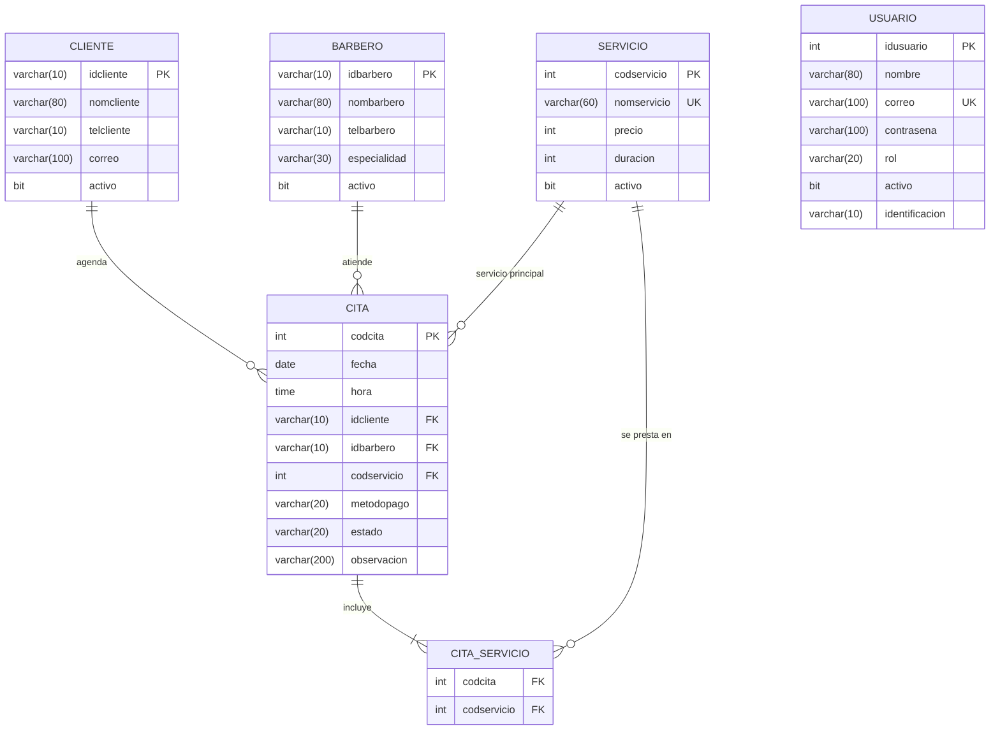

# La Navaja · Agenda de Citas para Barbería

## 1. Nombre y Descripción del Proyecto

**Nombre del proyecto:** `La Navaja` (`barberia`)

**Descripción:**  
Aplicación web Full-Stack desarrollada como Proyecto Integrador para **CESDE** (Backend II + Frontend). El sistema permite gestionar de extremo a extremo la operación de una barbería: administración de clientes, barberos, catálogo de servicios con precios/tiempos, agendamiento interactivo de citas con múltiples servicios, atención en silla y control de ingresos por barbero.

**¿A quién está dirigida?**  
La aplicación está dirigida a los cuatro actores principales del negocio, cada uno con permisos y vistas adaptadas a su rol:
- **Administrador:** Dueño o gerente de la barbería (control total del sistema, precios, personal, usuarios e indicadores financieros).
- **Recepcionista:** Personal de recepción encargado de agendar citas, registrar clientes y coordinar la agenda diaria.
- **Barbero:** Profesional que consulta su propia agenda del día, adiciona servicios extra solicitados por el cliente durante la atención y marca las citas como **Cumplidas (`Atendida`)** o **`Incumplidas`**.
- **Cliente:** Usuario final que se registra para consultar el catálogo de servicios, precios, barberos disponibles y agendar o cancelar sus propias citas.

---

## 2. Tecnologías Utilizadas

| Componente | Tecnología / Herramienta | Versión | Uso en el proyecto |
|---|---|---|---|
| **Lenguaje Backend** | Java (OpenJDK / Eclipse Temurin) | 17 | Lenguaje principal del servidor y lógica de negocio |
| **Framework Backend** | Spring Boot (`webmvc`, `data-jpa`, `security-crypto`, `actuator`) | 4.1.1 | Creación de la API REST, inyección de dependencias y persistencia |
| **Base de Datos** | MySQL (XAMPP) | 8.0+ / MariaDB | Almacenamiento relacional de clientes, barberos, servicios, citas y usuarios |
| **Construcción y Dependencias** | Apache Maven (`mvnw`) | 3.9.16 | Gestión de dependencias (`pom.xml`), compilación y empaquetado |
| **Mapeo de Objetos** | MapStruct | 1.6.3 | Conversión automática entre Entidades/Proyecciones y objetos `DTO` |
| **Documentación API** | Swagger / Springdoc OpenAPI (`springdoc-openapi-starter-webmvc-ui`) | 2.8.13 | Interfaz gráfica interactiva para visualizar y probar los endpoints REST |
| **Frontend** | React + Vite + React Router + Axios | React 19 / Vite 6 | Interfaz gráfica de usuario (SPA), consumo de API y rutas protegidas |
| **Pruebas Unitarias** | JUnit 5 (Backend) / Vitest + Testing Library (Frontend) | 3.x | Validación automatizada de reglas de negocio y componentes |

---

## 3. Arquitectura Utilizada

El backend está organizado bajo el paquete base `com.cesde.barberia` siguiendo una **arquitectura en capas** claramente separadas:

- **Entity (`com.cesde.barberia.modelo`):** Representa las entidades del dominio con sus atributos, anotaciones JPA (`@Entity`, `@Table`, `@Id`, `@ManyToOne`, `@ManyToMany`), validaciones de columna y documentación `@Schema` de Swagger.
  - Clases: `Cliente`, `Barbero`, `Servicio`, `Cita`, `Usuario`, `Catalogos`.
- **Repository (`com.cesde.barberia.repositorio`):** Gestiona el acceso a la base de datos mediante interfaces que extienden `JpaRepository`, incluyendo consultas derivadas, JPQL (`@Query`) y consultas SQL nativas con proyecciones.
  - Interfaces: `ICliente`, `IBarbero`, `IServicio`, `ICita`, `IUsuario`.
- **Service (`com.cesde.barberia.servicio`):** Contiene todas las reglas de negocio, validaciones de integridad referencial, horarios, cruces de agenda y cifrado de contraseñas (`BCrypt`). Lanza excepciones controladas (`ReglaNegocioException`, `NoEncontradoException`).
  - Clases: `SCliente`, `SBarbero`, `SServicio`, `SCita`, `SUsuario`, `Validador`.
- **Controller (`com.cesde.barberia.controlador`):** Recibe las solicitudes HTTP REST (`GET`, `POST`, `PUT`, `DELETE`), invoca la capa `Service` dentro de bloques `try-catch` y devuelve respuestas `ResponseEntity` con códigos HTTP estándar (`200 OK`, `201 CREATED`, `400 BAD REQUEST`, `401 UNAUTHORIZED`, `404 NOT FOUND`, `500 INTERNAL SERVER ERROR`).
  - Clases: `CCliente`, `CBarbero`, `CServicio`, `CCita`, `CUsuario`, `CAuth`.

### Capas de Apoyo (DTO y Mapper)
> **Nota:** Aunque no forman parte de las cuatro capas clásicas, el proyecto implementa las capas **DTO** y **Mapper** para desacoplar el modelo de base de datos de las respuestas JSON:
- **DTO (`com.cesde.barberia.dto`):** Objetos de transferencia de datos (`record` de Java) que viajan entre el cliente y el servidor sin exponer datos sensibles (como contraseñas cifradas) ni generar ciclos infinitos en las relaciones JPA.
  - Records: `CitaDTO`, `CitaRegistroDTO`, `ResumenBarberoDTO`, `UsuarioDTO`, `UsuarioRegistroDTO`, `LoginDTO`.
- **Mapper (`com.cesde.barberia.mapper`):** Interfaces anotadas con `@Mapper(componentModel = "spring")` donde **MapStruct** genera en tiempo de compilación el código que transforma las entidades (`Cita`, `Usuario`) y proyecciones (`IResumenBarberoProjection`) en sus respectivos `DTO`.
  - Interfaces: `ICitaMapper`, `IResumenBarberoMapper`, `IUsuarioMapper`.

---

## 4. Diagrama Entidad-Relacional



El script SQL de respaldo se encuentra en `barberia-backend/database/barberia.sql`.

---

## 5. Requisitos Previos y Variables de Entorno

1. **Lenguaje de programación:** Java JDK **17** o superior.
2. **Gestor de dependencias Backend:** Apache Maven **3.9+** (el proyecto incluye el wrapper `mvnw.cmd`, por lo que no requiere instalación manual).
3. **Entorno Frontend:** Node.js **20** o superior y `npm`.
4. **Base de datos:** MySQL ejecutándose en el puerto `3306` (por ejemplo, mediante **XAMPP**).
   - **Usuario:** `root`
   - **Contraseña:** *(vacía)*
   - **Base de datos:** `barberia` *(se crea automáticamente al iniciar el backend gracias a `createDatabaseIfNotExist=true` y `ddl-auto=update`)*.
5. **Variables de entorno:**
   - `JAVA_HOME`: Debe apuntar a la carpeta de instalación de JDK 17 (ej. `C:\Program Files\Eclipse Adoptium\jdk-17.0.20.101-hotspot`).
   - `VITE_API_URL` *(opcional en el frontend)*: URL del backend. Por defecto toma `http://localhost:8080`.

---

## 6. Instalación y Configuración del Aplicativo

### Paso 1: Clonar el repositorio
```bash
git clone <URL_DEL_REPOSITORIO_EN_GITHUB>
cd "proytecto integrador3"
```

### Paso 2: Iniciar la Base de Datos
1. Abrir el panel de control de **XAMPP**.
2. Hacer clic en **Start** sobre el módulo **MySQL** (verificar que quede en el puerto `3306`).
3. *(Opcional)* Si deseas crear las tablas manualmente antes de arrancar, puedes ejecutar el script `barberia-backend/database/barberia.sql` en phpMyAdmin o MySQL Workbench.

### Paso 3: Iniciar el Backend (Spring Boot)
Abrir una terminal en la raíz del proyecto y ejecutar:
```powershell
cd barberia-backend
.\mvnw.cmd spring-boot:run
```
> Al arrancar por primera vez, la clase `DatosIniciales.java` poblará automáticamente las tablas con servicios, barberos, clientes y cuentas de usuario de demostración.

### Paso 4: Instalar e iniciar el Frontend (React + Vite)
Abrir una **segunda terminal** en la raíz del proyecto y ejecutar:
```powershell
cd barberia-frontend
npm install
npm run dev
```

### Atajo desde Visual Studio Code / IDE
También puedes iniciar ambos servidores al tiempo presionando `Ctrl + Shift + P` → `Tasks: Run Task` → **`Iniciar Proyecto Completo (Backend + Frontend)`**.

---

## 7. Configuración Interna, URLs, Puertos y Credenciales

### URLs y Puertos del Aplicativo

| Servicio | Ubicación de configuración | Puerto | URL de acceso |
|---|---|---|---|
| **Backend (API REST)** | `barberia-backend/src/main/resources/application.properties` | `8080` | `http://localhost:8080` |
| **Swagger UI (OpenAPI)** | `barberia-backend/src/main/resources/application.properties` | `8080` | `http://localhost:8080/doc/swagger-ui/index.html` *(o `/doc/swagger-ui.html`)* |
| **Base de datos MySQL** | `barberia-backend/src/main/resources/application.properties` | `3306` | `jdbc:mysql://localhost:3306/barberia` |
| **Frontend (React + Vite)** | `barberia-frontend/vite.config.js` | `5173` | `http://localhost:5173` |

### Credenciales de Ingreso por Rol (Cuentas de Demostración)

| Rol | Correo de ingreso | Contraseña | Permisos asignados en la aplicación |
|---|---|---|---|
| **Administrador** | `admin@barberia.com` | `Barberia2026*` | Acceso total: gestiona usuarios, servicios/precios, barberos, clientes, citas y ve el reporte de ingresos. |
| **Barbero** | `andres@barberia.com` | `Barberia2026*` | Ve su agenda asignada, adiciona servicios extra durante la atención en silla y marca citas como `Atendida` o `Incumplida`. *(También disponibles: `julian@barberia.com`, `camila@barberia.com`)*. |
| **Cliente** | `santiago@correo.com` | `Barberia2026*` | Consulta precios/barberos, agenda sus propias citas seleccionando uno o varios servicios y puede cancelar sus citas pendientes. *(También disponible: `mateo@correo.com`)*. |

> **Nota sobre Recepcionista:** Puedes crear una cuenta con rol `Recepcionista` desde el módulo **Usuarios** (entrando como Administrador). El recepcionista gestiona toda la agenda de citas y el directorio de clientes, pero no puede alterar los precios de los servicios ni eliminar registros maestros.

---

## 8. Documentación de Puntos Finales (Endpoints) de los Controladores

### Controlador de Clientes (`CCliente` — `/clientes`)
- `GET    /clientes/@GetMapping` — Consulta todos los clientes registrados.
- `GET    /clientes/@GetMapping("/{idcliente}")` — Consulta un cliente por llave primaria (`idcliente`).
- `GET    /clientes/@GetMapping("/buscar")` — Busca clientes por coincidencia parcial en el nombre (`?nombre=`).
- `POST   /clientes/@PostMapping` — Adiciona un nuevo registro de cliente.
- `PUT    /clientes/@PutMapping("/{idcliente}")` — Modifica la información de un cliente por su llave primaria.
- `DELETE /clientes/@DeleteMapping("/{idcliente}")` — Elimina un cliente (valida que no tenga citas asociadas).

### Controlador de Barberos (`CBarbero` — `/barberos`)
- `GET    /barberos/@GetMapping` — Consulta general de todos los barberos.
- `GET    /barberos/@GetMapping("/{idbarbero}")` — Consulta un barbero por llave primaria (`idbarbero`).
- `GET    /barberos/@GetMapping("/buscar")` — Busca barberos por parte del nombre (`?nombre=`).
- `POST   /barberos/@PostMapping` — Adiciona un registro de barbero.
- `PUT    /barberos/@PutMapping("/{idbarbero}")` — Modifica un registro de barbero.
- `DELETE /barberos/@DeleteMapping("/{idbarbero}")` — Elimina un barbero (si no tiene citas registradas).

### Controlador de Servicios (`CServicio` — `/servicios`)
- `GET    /servicios/@GetMapping` — Consulta el catálogo completo de servicios con precios y duración.
- `GET    /servicios/@GetMapping("/{codservicio}")` — Consulta un servicio por llave primaria (`codservicio`).
- `GET    /servicios/@GetMapping("/buscar")` — Busca servicios por parte del nombre (`?nombre=`).
- `POST   /servicios/@PostMapping` — Adiciona un nuevo servicio (valida nombre único).
- `PUT    /servicios/@PutMapping("/{codservicio}")` — Modifica precio, nombre, duración o estado de un servicio.
- `DELETE /servicios/@DeleteMapping("/{codservicio}")` — Elimina un servicio (si no tiene citas asociadas).

### Controlador de Citas (`CCita` — `/citas`)
- `GET    /citas/@GetMapping` — Consulta general de citas (incluye servicios, precio total y duración total).
- `GET    /citas/@GetMapping("/{codcita}")` — Consulta una cita por su llave primaria (`codcita`).
- `GET    /citas/@GetMapping("/filtrar")` — Filtra citas por parámetros opcionales (`?fecha=&idbarbero=&estado=`).
- `GET    /citas/@GetMapping("/resumen-barberos")` — Consulta nativa con proyección y `Mapper`: citas atendidas e ingresos por barbero.
- `POST   /citas/@PostMapping` — Agenda una cita nueva validando horarios, disponibilidad y servicios seleccionados.
- `PUT    /citas/@PutMapping("/{codcita}")` — Modifica los datos y servicios de una cita existente.
- `PUT    /citas/@PutMapping("/{codcita}/estado")` — Marca rápidamente el estado de la cita (`Pendiente`, `Atendida`, `Incumplida`, `Cancelada`).
- `POST   /citas/@PostMapping("/{codcita}/servicios/{codservicio}")` — Adiciona un servicio extra a una cita durante la atención.
- `DELETE /citas/@DeleteMapping("/{codcita}")` — Elimina una cita por su llave primaria.

### Controlador de Usuarios (`CUsuario` — `/usuarios`) y Acceso (`CAuth` — `/auth`)
- `GET    /usuarios/@GetMapping` — Consulta general de usuarios del sistema (retorna `UsuarioDTO` sin contraseña).
- `GET    /usuarios/@GetMapping("/{idusuario}")` — Consulta un usuario por llave primaria (`idusuario`).
- `POST   /usuarios/@PostMapping` — Adiciona un usuario eligiendo rol y estado (cifra contraseña con `BCrypt`).
- `PUT    /usuarios/@PutMapping("/{idusuario}")` — Modifica un usuario.
- `DELETE /usuarios/@DeleteMapping("/{idusuario}")` — Elimina un usuario (protegiendo que quede al menos un administrador activo).
- `POST   /auth/@PostMapping("/registro")` — Registro público de cuenta de cliente.
- `POST   /auth/@PostMapping("/login")` — Inicio de sesión validando correo y contraseña cifrada.
- `GET    /auth/@GetMapping("/catalogos")` — Devuelve las listas de especialidades, métodos de pago, estados de cita y roles.

---

## 9. Documentación de la API con Swagger (OpenAPI)

Swagger permite visualizar, documentar y probar todos los servicios REST directamente desde el navegador sin necesidad de herramientas externas.

### Configuración implementada en el proyecto

1. **Dependencia en `barberia-backend/pom.xml`:**
   ```xml
   <dependency>
       <groupId>org.springdoc</groupId>
       <artifactId>springdoc-openapi-starter-webmvc-ui</artifactId>
       <version>2.8.13</version>
   </dependency>
   ```

2. **Propiedades en `barberia-backend/src/main/resources/application.properties`:**
   ```properties
   springdoc.api-docs.enabled=true
   spring.swagger-ui.enabled=true
   springdoc.swagger-ui.enabled=true
   springdoc.swagger-ui.path=/doc/swagger-ui.html
   ```
   - `springdoc.api-docs.enabled=true`: Activa la generación de la especificación OpenAPI.
   - `spring.swagger-ui.enabled=true` / `springdoc.swagger-ui.enabled=true`: Activa la interfaz gráfica de Swagger UI.
   - `springdoc.swagger-ui.path=/doc/swagger-ui.html`: Define la ruta personalizada para acceder desde el navegador.

3. **Anotaciones en Controladores y Modelos:**
   - `@Tag(name = "...", description = "...")` en cada clase controladora (`CCliente`, `CBarbero`, `CServicio`, `CCita`, `CUsuario`, `CAuth`) para describir el propósito del controlador.
   - `@Operation(summary = "...", description = "...")` en cada método HTTP para documentar qué hace cada endpoint.
   - `@Schema(description = "...", example = "...")` en los atributos de las entidades del paquete `modelo` (`Cliente`, `Barbero`, `Servicio`, `Cita`, `Usuario`) para mostrar descripciones y valores de ejemplo en la sección **Schemas** de Swagger.

4. **Cómo ingresar y probar en Swagger:**
   - Con el backend en ejecución, abre en el navegador:  
     👉 **http://localhost:8080/doc/swagger-ui/index.html** *(o http://localhost:8080/doc/swagger-ui.html)*
   - Haz clic sobre cualquiera de los métodos (por ejemplo, `GET /clientes/{idcliente}`), presiona el botón **Try it out**, escribe una cédula de ejemplo (ej. `1017123456`) y presiona **Execute** para ver el código de respuesta `200` y el cuerpo JSON.

---

## 10. Cómo Realizar Pruebas Unitarias

### Pruebas automatizadas en el Frontend (Vitest + Testing Library)
Evalúan las validaciones de campos (obligatoriedad, longitudes, formato de correo, números, horarios de 08:00 a 20:00, fechas no anteriores a hoy), el filtro/buscador sin tildes y el flujo de inicio de sesión:
```powershell
cd barberia-frontend
npm test
```

### Pruebas en el Backend con Maven
Para ejecutar el ciclo de validación y pruebas del backend con Maven:
```powershell
cd barberia-backend
.\mvnw.cmd test
```

---

## 11. Licencia y Derechos de Autor

**Derechos de Autor:**  
© 2026 — Proyecto Académico desarrollado para **CESDE** (Técnico en Desarrollo de Software — Submódulos de Backend II y Frontend).

**Licencia:**  
Este proyecto se distribuye bajo la licencia **MIT** para fines educativos y académicos. Se permite su uso, estudio y modificación citando a los autores originales.
