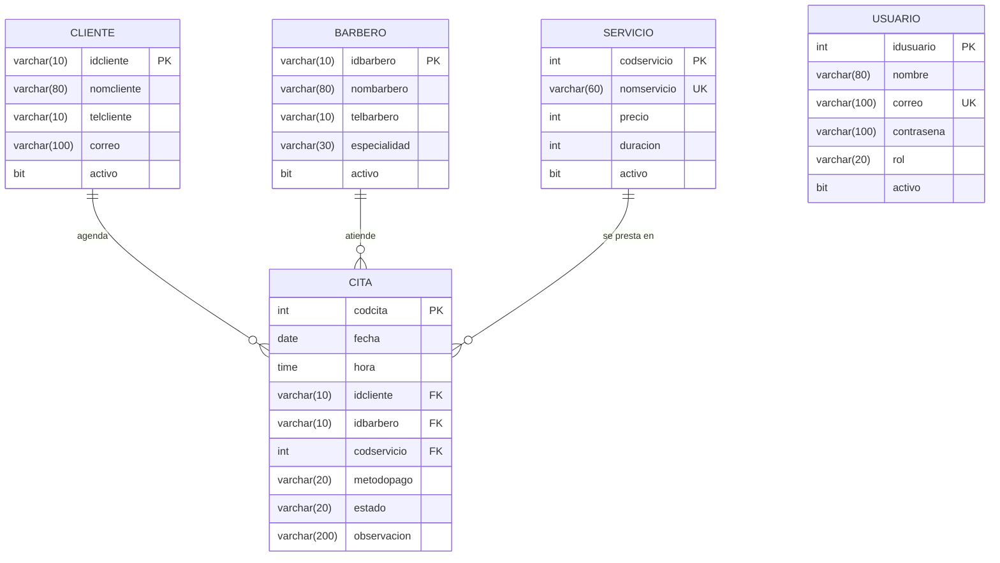

# La Navaja · Agenda de citas para barbería

Proyecto integrador CESDE (Backend II + Frontend). Aplicación para que una barbería
administre sus clientes, barberos, servicios y la agenda de citas. Está dirigida al
administrador y a la recepción del negocio.

## Tecnologías

| Parte | Tecnologías |
|---|---|
| Backend | Java 17, Spring Boot 4.1.1, Spring Data JPA, Maven, MapStruct, Swagger (springdoc) |
| Base de datos | MySQL (XAMPP) |
| Frontend | React 19, Vite, React Router, axios, Vitest + Testing Library |

## Arquitectura del backend

Paquete base `com.cesde.barberia`, en cuatro capas:

- **modelo**: entidades con sus atributos y relaciones (`Cliente`, `Barbero`, `Servicio`, `Cita`, `Usuario`).
- **repositorio**: acceso a datos (`ICliente`, `IBarbero`, `IServicio`, `ICita`, `IUsuario`).
- **servicio**: reglas de negocio (`SCliente`, `SBarbero`, `SServicio`, `SCita`, `SUsuario`, `Validador`).
- **controlador**: recibe las solicitudes HTTP (`CCliente`, `CBarbero`, `CServicio`, `CCita`, `CUsuario`, `CAuth`).

Capas de apoyo: **dto** (records que viajan entre capas), **mapper** (MapStruct convierte
entidades y proyecciones en DTO), **excepcion** y **config** (datos iniciales).

Los `try` están en las capas de Servicio y Controlador. El servicio lanza
`ReglaNegocioException` o `NoEncontradoException`; el controlador las atrapa y responde
400 o 404 con el mensaje como texto.

## Diagrama relacional



El script equivalente está en `barberia-backend/database/barberia.sql`.

## Reglas de negocio (capa de Servicio)

- No se elimina un cliente, barbero o servicio que tenga citas (integridad referencial).
- El cliente, el barbero y el servicio deben existir antes de adicionar o modificar una cita.
- Una cita nueva o pendiente no puede tener una fecha anterior a hoy.
- La hora de la cita debe estar entre las 08:00 y las 20:00.
- Un barbero no puede tener dos citas a la misma fecha y hora.
- No se agenda una cita nueva con un cliente, barbero o servicio inactivo.
- No puede haber dos servicios con el mismo nombre ni dos usuarios con el mismo correo.
- Siempre debe quedar al menos un administrador activo.
- Cada campo se valida en tipo y extensión según su tabla.

## Requisitos previos

- JDK 17 o superior
- XAMPP con MySQL en el puerto 3306 (usuario `root`, sin contraseña)
- Node.js 20 o superior

## Cómo ejecutar

1. Abrir XAMPP e iniciar **MySQL**.
2. Backend (crea la base de datos `barberia` y sus tablas automáticamente):

   ```bash
   cd barberia-backend
   ./mvnw spring-boot:run
   ```

   También se puede abrir la carpeta `barberia-backend` en IntelliJ IDEA y ejecutar `BarberiaApplication`.

3. Frontend:

   ```bash
   cd barberia-frontend
   npm install
   npm run dev
   ```

4. Abrir `http://localhost:5173`.

La primera vez se cargan datos de ejemplo y una cuenta de administrador de demostración:
correo `admin@barberia.com`, contraseña `Barberia2026*` (definida en
`config/DatosIniciales.java`; conviene cambiarla después del primer ingreso).

## Configuración

| Qué | Dónde | Valor |
|---|---|---|
| Puerto del backend | `application.properties` | 8080 |
| Conexión a MySQL | `application.properties` | `jdbc:mysql://localhost:3306/barberia` |
| URL de la API en el front | variable `VITE_API_URL` | `http://localhost:8080` |
| Swagger | navegador | `http://localhost:8080/doc/swagger-ui.html` |

## Endpoints

Los controladores de clientes, barberos y servicios tienen las mismas operaciones:

| Método | Ruta | Qué hace |
|---|---|---|
| GET | `/clientes` | Consulta general |
| GET | `/clientes/{idcliente}` | Consulta por llave primaria |
| GET | `/clientes/buscar?nombre=` | Busca por parte del nombre |
| POST | `/clientes` | Adiciona un registro |
| PUT | `/clientes/{idcliente}` | Modifica un registro |
| DELETE | `/clientes/{idcliente}` | Elimina un registro |

Lo mismo aplica para `/barberos`, `/servicios` y `/usuarios` (este último sin `buscar`).

| Método | Ruta | Qué hace |
|---|---|---|
| GET | `/citas` | Consulta general de citas |
| GET | `/citas/{codcita}` | Consulta una cita |
| GET | `/citas/filtrar?fecha=&idbarbero=&estado=` | Filtra citas (parámetros opcionales) |
| GET | `/citas/resumen-barberos` | Ingresos por barbero (consulta nativa con proyección y mapper) |
| POST | `/citas` | Agenda una cita |
| PUT | `/citas/{codcita}` | Modifica una cita |
| DELETE | `/citas/{codcita}` | Elimina una cita |
| POST | `/auth/registro` | Crea una cuenta (rol Recepcionista) |
| POST | `/auth/login` | Inicia sesión |
| GET | `/auth/catalogos` | Listas de opciones (especialidades, métodos de pago, estados, roles) |

## Frontend

- **Rutas**: `/login` y `/registro` son públicas; el resto exige sesión (`RutaProtegida`).
  `/usuarios` además exige rol Administrador.
- **Hooks**: `useState` y `useEffect` en las páginas, `useContext` para la sesión (`AuthContext`).
- **Módulos**: citas, clientes, barberos, servicios y usuarios, cada uno con tabla, buscador,
  filtros y formulario. Todos se arman desde `src/configs/modulos.js`.
- **Validaciones**: `src/utils/validaciones.js` revisa tipo, extensión, campos obligatorios y fechas
  antes de enviar. Se usan listas desplegables, botones de radio y casillas donde las opciones son conocidas.

## Pruebas

```bash
cd barberia-frontend
npm test
```

Incluye 17 pruebas: validaciones de formularios, buscador y filtros, y el formulario de inicio de sesión.

## Alcance del inicio de sesión

El login valida correo y contraseña (cifrada con BCrypt) y el front guarda la sesión en
`localStorage`. Los endpoints del backend no exigen token: la restricción de acceso se hace
en las rutas del front. Proteger la API con JWT sería la siguiente mejora.

## Autores

Proyecto académico — CESDE, Técnico en Desarrollo de Software.
